# post-sse

**Zero-dependency, fetch-based Server-Sent Events client — the POST, custom headers, `AbortSignal`, and opt-in reconnection that the browser's `EventSource` can't do. For Node, the browser, and Bun.**

<p>
  <a href="https://www.npmjs.com/package/post-sse"></a>
  <a href="https://github.com/H1manshu01/post-sse/actions/workflows/ci.yml"></a>
  <a href="https://bundlephobia.com/package/post-sse"></a>
  
  <a href="./LICENSE"></a>
</p>



The browser's `EventSource` is the obvious way to read a `text/event-stream` — except it can **only `GET`** and **can't send a header**. Every LLM streaming endpoint needs the opposite: a `POST` with an `Authorization` header and a JSON body. So you reach for `fetch`, and now you own the hard part — decoding bytes into events across chunk and UTF-8 boundaries, cancelling cleanly on abort, and deciding what a dropped connection means.

`post-sse` is that layer: a `fetch`-based SSE client you consume with `for await`, that POSTs, sends headers, aborts without leaking a reader, and reconnects **only when you ask it to**.

```ts
import { sse } from "post-sse";

const controller = new AbortController();

for await (const event of sse("https://api.openai.com/v1/chat/completions", {
  method: "POST",
  headers: { authorization: `Bearer ${key}`, "content-type": "application/json" },
  body: JSON.stringify({ model, stream: true, messages }),
  signal: controller.signal,
})) {
  if (event.data === "[DONE]") break;       // provider sentinel — not JSON
  const delta = JSON.parse(event.data);      // { event?, data, id? }
  render(delta);
}
```

That's the whole surface for the common case: open the stream, iterate events, `break` when you're done. Each `event` is `{ event?, data, id? }`.

## Why another one?

`EventSource` is a browser built-in, and the npm ecosystem has several polyfills and `fetch`-based clients. But an **LLM stream** specifically needs: a POST body, custom auth headers, an `AbortSignal` you already have from the rest of your app, an ergonomic async-iterable API, and reconnection that understands that a *clean* stream end means **the answer is finished**, not that it should reconnect. Most options solve some of that; the gaps are exactly where LLM streaming lives.

| | post-sse | native `EventSource` | `@microsoft/fetch-event-source` | `eventsource` (npm) | `launchdarkly-eventsource` |
|---|:---:|:---:|:---:|:---:|:---:|
| POST + custom headers | ✅ | — | ✅ | ✅ | ✅ |
| `AbortSignal` cancellation | ✅ | ⚠️ `.close()` only | ✅ | ⚠️ `.close()` only | ⚠️ `.close()` only |
| `for await` async-iterable API | ✅ | — (callbacks) | — (callbacks) | — (callbacks) | — (callbacks) |
| Opt-in reconnection w/ `Last-Event-ID` | ✅ opt-in | ✅ always-on | ⚠️ manual in `onclose` | ✅ always-on | ✅ always-on |
| Node **and** browser | ✅ | ⚠️ browser (Node 21+ only) | ✅ | ⚠️ Node-oriented | ⚠️ Node-oriented |
| Zero runtime dependencies | ✅ | n/a (built-in) | ✅ | ⚠️ | ⚠️ |
| Typed events (`SSEEvent<E>`) | ✅ | ⚠️ loose | ⚠️ partial | ⚠️ | ⚠️ |

Comparison claims about third-party libraries are **as of early 2026** — re-check each project before quoting it. See [COMPETITORS.md](./COMPETITORS.md) for the full scan with specifics.

## Where it fits

`post-sse` is the **transport** step of a streaming structured-output pipeline, and sits **first** — it's the package that turns a `fetch` into a stream of events. Its siblings (same author) pick up from there:

```
fetch → SSE (post-sse) → parse partial JSON (trickle-json) → repair/coerce to schema (coerce-json) → validate
```

- **[`post-sse`](https://www.npmjs.com/package/post-sse)** — POST the request, stream the events. *(this package)*
- **[`trickle-json`](https://www.npmjs.com/package/trickle-json)** — assemble the streamed token deltas into the best valid partial value available on every chunk, without throwing.
- **[`coerce-json`](https://www.npmjs.com/package/coerce-json)** — repair and coerce that value to fit your Zod / JSON Schema, logging every fix.

Each is zero-dependency and useful on its own; together they're a progressive, typed, schema-fitted streaming flow. A [worked composition example](#composing-the-pipeline) is below.

## Install

```sh
npm install post-sse
```

Zero runtime dependencies. Ships ESM + CJS + `.d.ts`, ~1.4 kB min+brotli. Runs anywhere there's a global `fetch` and `ReadableStream`: **Node ≥ 18**, modern **browsers**, and **Bun**. On older runtimes without a global `fetch`, inject one via the `fetch` option.

## API

Single entry point, no subpaths.

```ts
import { sse, parseSSE, json, SSEError } from "post-sse";
import type { SSEEvent, SSEInit, ReconnectOptions, ParseOptions } from "post-sse";
```

### `sse(url, init?) → AsyncGenerator<SSEEvent>`

The fetch-based client. Opens an SSE stream over `fetch` and yields one `{ event?, data, id? }` per dispatched event. Consume it with `for await`:

```ts
for await (const event of sse(url, { method: "POST", headers, body, signal })) {
  // ...
}
```

- Forwards `method`, `body`, `headers`, and everything else in `init` to `fetch`.
- Auto-sets `accept: text/event-stream` if you didn't supply an `accept` header.
- Passes your `signal` straight through to `fetch`, so abort cancels the in-flight request too.
- A **non-2xx** response throws [`SSEError`](#sseerror) (with `.status`) and cancels the response body.
- A response with **no body** throws `SSEError`.
- Tracks the last seen event `id` and, on a reconnect, resumes from it via `Last-Event-ID`.
- Generic over the event-name union: `sse<"delta" | "done">(url, init)` types `event.event`.

Reconnection is **off by default** — see [Reconnection](#reconnection).

### `parseSSE(source, options?) → AsyncGenerator<SSEEvent>`

The raw, transport-agnostic parser underneath `sse()`. Turns any `AsyncIterable<string | Uint8Array>` — a `response.body`, a file stream, a mock, a WebSocket-to-SSE bridge — into discrete events. Use it when you already have a byte/text stream and just want it parsed:

```ts
import { parseSSE } from "post-sse";

for await (const event of parseSSE(myByteStream, { onRetry: (ms) => console.log("retry", ms) })) {
  // event: { event?, data, id? }
}
```

It implements the SSE wire format carefully (see [Guardrails](#guardrails)):

- **CR, LF, and CRLF** line terminators — including a CRLF **split across two chunks**.
- **Multi-line `data:`** joined with `\n`; a block with no `data:` is not dispatched (per spec).
- Exactly one leading space stripped after the field colon; `data` with no colon yields `""`.
- `:`-prefixed **comment** lines ignored; a leading **UTF-8 BOM** stripped once.
- An `id:` containing a **NUL** is ignored (per spec).
- A numeric `retry:` directive is surfaced via `options.onRetry(ms)`.
- Buffers across **chunk and UTF-8 boundaries**, so a multibyte character split mid-sequence is decoded correctly, and a final line with no trailing newline is still dispatched.

`options.onRetry?(retryMs: number)` is the only option ([`ParseOptions`](#types)).

### `json(event) → T`

Convenience for the common case where each event's `data` is a JSON chunk (OpenAI/Anthropic deltas):

```ts
import { sse, json } from "post-sse";

for await (const event of sse(url, init)) {
  if (event.data === "[DONE]") break;   // guard sentinels first — they aren't JSON
  const delta = json<ChatDelta>(event); // JSON.parse(event.data), typed
}
```

It's `JSON.parse(event.data)` with a type parameter. It **throws** on non-JSON payloads like the `[DONE]` sentinel, so guard those before calling it.

### `SSEError`

Thrown when the server responds with a non-2xx status or has no body.

```ts
import { sse, SSEError } from "post-sse";

try {
  for await (const event of sse(url, init)) { /* ... */ }
} catch (err) {
  if (err instanceof SSEError) {
    console.error(err.status, err.response?.statusText); // e.g. 429 "Too Many Requests"
  }
}
```

| Property | Type | Notes |
|---|---|---|
| `status` | `number \| undefined` | HTTP status for a non-2xx response; absent when there was no response (e.g. missing body). |
| `response` | `Response \| undefined` | The original `Response`, so you can read error headers or the body. |

Aborting does **not** throw `SSEError` — it throws an `AbortError` `DOMException` (or your `signal.reason`), the standard abort signal, so you can treat cancellation separately from a server error.

## Options

`sse()` takes an `SSEInit`, which is a `RequestInit` (minus `signal`, re-typed below) plus a few SSE-specific fields. Anything a `RequestInit` accepts — `method`, `headers`, `body`, `credentials`, `cache`, … — is forwarded to `fetch`.

| Option | Type | Default | What it does |
|---|---|---|---|
| `signal` | `AbortSignal \| null` | — | Standard abort signal. Passed to `fetch`, aborts an in-flight request, cancels the reader, and cancels a pending reconnect delay. |
| `reconnect` | `boolean \| ReconnectOptions` | `false` | Opt-in reconnection. `true` for defaults, or an options object. Off by default. |
| `lastEventId` | `string` | — | Resume id sent as `Last-Event-ID` on the **first** request. |
| `fetch` | `typeof fetch` | `globalThis.fetch` | Inject a custom `fetch` (older runtimes, tests, instrumentation). |
| *(…RequestInit)* | — | — | `method`, `headers`, `body`, and the rest, forwarded to `fetch`. |

### `ReconnectOptions`

| Option | Type | Default | What it does |
|---|---|---|---|
| `maxRetries` | `number` | `10` | Max reconnect attempts after a transport error before the error is rethrown. |
| `initialDelay` | `number` (ms) | `1000` | Base delay before the first retry. Overridden by a server `retry:` directive if one was seen. |
| `maxDelay` | `number` (ms) | `30000` | Ceiling for the (pre-jitter) backoff delay. |
| `backoff` | `(attempt: number, baseDelay: number) => number` | equal-jitter exponential | Custom backoff. Receives the 0-based `attempt` and the current `baseDelay`; returns the delay in ms. |

The default backoff is **equal-jitter exponential**: it computes `exp = min(baseDelay * 2 ** attempt, maxDelay)`, then waits `exp/2 + random(0, exp/2)` — half fixed, half random — to avoid a reconnect thundering herd. Supply `backoff` to replace it entirely (e.g. `() => 0` in tests).

## Reconnection

Reconnection is **opt-in** and deliberately conservative, because for an LLM stream the two ways a stream can end mean opposite things:

- **A clean stream end means completion.** When the server closes the stream normally, the response is *done* — the model finished its answer. `sse()` returns; it does **not** reconnect. Reconnecting here would re-request a completed generation.
- **A transport error means the connection dropped mid-answer.** Only *this* triggers a reconnect (when you've enabled it). `sse()` waits a backoff delay, re-issues the request with `Last-Event-ID` set to the last event `id` it saw, and continues yielding into the same `for await` loop — the consumer never notices.

```ts
for await (const event of sse(url, {
  method: "POST",
  headers,
  body,
  reconnect: true,                       // or { maxRetries: 5, initialDelay: 500 }
})) {
  handle(event);
}
```

Details:

- The last event `id` is tracked automatically as events stream; you only pass `lastEventId` to resume an *earlier* session.
- A server `retry:` directive (surfaced by the parser) becomes the backoff **base delay** for subsequent reconnects.
- After `maxRetries` exhausted attempts, the underlying transport error is rethrown.
- An abort during a reconnect **wait** rejects immediately with the abort reason — the pending delay is cancelled, not slept out.

## Guardrails

The fiddly parts of a hand-rolled `fetch` SSE loop are where bugs hide. `post-sse` handles them, covered by unit and property tests (`test/parse.test.ts`, `test/transport.test.ts`):

- **No leaked readers.** The underlying `ReadableStream` reader is acquired in one place and **always cancelled in a `finally`** — on a clean end, an early `break`/`return` out of the `for await`, an abort, or a thrown error. The connection is never left dangling.
- **Abort-safe.** With a `signal`, each read races the abort; aborting rejects with `signal.reason` (or a standard `AbortError`), cancels the reader, and cancels any pending reconnect delay. On a non-2xx, the response body is cancelled before the `SSEError` is thrown.
- **Correct across chunk and UTF-8 boundaries.** Bytes are decoded with a streaming `TextDecoder` and buffered, so a line split mid-way — or a multibyte character split mid-sequence — reassembles correctly. A property test asserts that **splitting the same payload at every byte offset** (and at random multi-point splits) yields byte-for-byte the same events as a single-chunk parse.
- **Spec-faithful parsing.** CR/LF/CRLF (incl. a CRLF split across chunks), multi-line `data:`, one-space stripping, comments, BOM, NUL-in-`id`, and a final line with no terminator are all handled per the SSE spec.
- **Browser-safe stream reading.** Reads via `response.body.getReader()` rather than assuming the body is async-iterable (it isn't in browsers), so the same code path runs in Node, the browser, and Bun.

## Composing the pipeline

`post-sse` yields raw SSE events; its siblings turn those into a typed, schema-fitted value. Here's the full three-package flow — stream an LLM chat completion, assemble the streamed JSON as it arrives, and coerce the final value to a Zod schema:

```ts
import { sse } from "post-sse";
import { StreamingJsonParser } from "trickle-json";
import { coerce } from "coerce-json/zod";
import { z } from "zod";

const Answer = z.object({
  sentiment: z.enum(["positive", "neutral", "negative"]),
  score: z.number(),
  tags: z.array(z.string()).default([]),
});

const controller = new AbortController();
const parser = new StreamingJsonParser();
parser.on("snapshot", (partial) => renderPreview(partial)); // progressive UI, every chunk

// 1. post-sse: POST the request and stream SSE events
for await (const event of sse("https://api.openai.com/v1/chat/completions", {
  method: "POST",
  headers: { authorization: `Bearer ${key}`, "content-type": "application/json" },
  body: JSON.stringify({ model, stream: true, messages }),
  signal: controller.signal,
})) {
  if (event.data === "[DONE]") break;
  // 2. trickle-json: feed each delta's JSON text to the partial-JSON parser
  const delta = JSON.parse(event.data);
  const text = delta.choices?.[0]?.delta?.content;
  if (text) parser.write(text);
}

const raw = parser.end(); // best-effort value assembled from the stream

// 3. coerce-json: repair/coerce to the schema, with a change log
const { value, ok, changes } = coerce(raw, Answer);
if (ok) save(value);
else console.warn("could not fully repair:", changes);
```

`post-sse` owns the transport; `trickle-json` gives you the best value available on every chunk without throwing; `coerce-json` makes that value fit your schema and hands you the receipts. Each step is independent, so you can adopt just the one you need.

## Types

```ts
interface SSEEvent<E extends string = string> {
  event?: E;  // the `event:` field, if present
  data: string; // joined `data:` payload (multiple `data:` lines joined with "\n")
  id?: string;  // the `id:` field, if present
}

interface SSEInit extends Omit<RequestInit, "signal"> {
  signal?: AbortSignal | null;
  reconnect?: boolean | ReconnectOptions;
  lastEventId?: string;
  fetch?: typeof fetch;
}

interface ReconnectOptions {
  maxRetries?: number;    // default 10
  initialDelay?: number;  // default 1000 (ms)
  maxDelay?: number;      // default 30000 (ms)
  backoff?: (attempt: number, baseDelay: number) => number;
}

interface ParseOptions {
  onRetry?: (retryMs: number) => void;
}
```

## Development

```sh
npm install
npm test          # vitest (unit + property/fuzz tests via fast-check)
npm run typecheck
npm run build     # tsup → ESM + CJS + .d.ts
npm run size      # size-limit
npm run lint      # Biome
npm run smoke     # cross-runtime smoke test against built dist/ (Node + Bun)
```

## License

MIT © Himanshu Sharma
